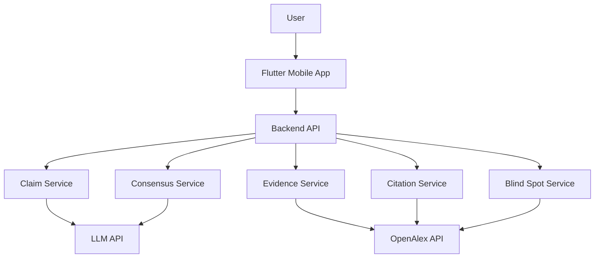
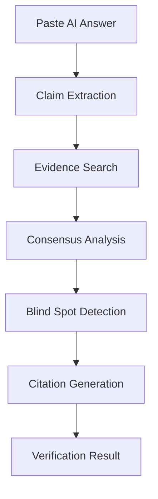

# System Design - VERITY

## Overview

VERITY adalah aplikasi mobile yang berfungsi sebagai lapisan verifikasi untuk platform AI seperti ChatGPT, Gemini, Claude, dan DeepSeek.

Sistem membantu pengguna memverifikasi jawaban AI dengan cara:

* Mengekstrak klaim dari jawaban AI
* Mencari bukti ilmiah yang relevan
* Mengukur tingkat konsensus penelitian
* Mengidentifikasi blind spot
* Menghasilkan sitasi akademik

---

## Goals

### Functional Goals

* Memverifikasi jawaban AI
* Menampilkan bukti ilmiah pendukung
* Menampilkan tingkat konsensus penelitian
* Menampilkan peringatan blind spot
* Menghasilkan sitasi APA, MLA, dan IEEE

### Non Functional Goals

* Response time < 10 detik
* Mobile friendly
* Mudah dikembangkan
* Modular architecture
* Mendukung integrasi AI provider baru

---

## High Level Architecture



---

## User Flow



---

## Core Features

### Claim Extractor

Tujuan:

Memecah jawaban AI menjadi beberapa klaim yang dapat diverifikasi secara independen.

Input:

* AI Response

Output:

* List of Claims

Contoh:

Input:

"Penggunaan media sosial lebih dari 3 jam per hari meningkatkan risiko depresi pada remaja."

Output:

* Media sosial meningkatkan risiko depresi
* Penggunaan lebih dari 3 jam per hari meningkatkan risiko depresi
* Remaja lebih rentan terhadap dampak media sosial

---

### Evidence Finder

Tujuan:

Mencari publikasi ilmiah yang relevan terhadap klaim.

Input:

* Claim

Output:

* Daftar paper
* Judul
* Penulis
* Tahun
* DOI
* URL

Data Source:

* OpenAlex

---

### Consensus Meter

Tujuan:

Mengukur tingkat dukungan penelitian terhadap suatu klaim.

Kategori:

* Support
* Neutral
* Oppose

Rumus MVP:

score = ((support - oppose) / total_paper) × 100

Level:

| Score  | Level         |
| ------ | ------------- |
| 80-100 | High          |
| 50-79  | Medium        |
| 20-49  | Low           |
| 0-19   | Weak          |
| < 0    | Contradictory |

Contoh:

Support = 8

Neutral = 1

Oppose = 1

Score = 70

Level = Medium

---

### Blind Spot Alert

Tujuan:

Mendeteksi perspektif yang tidak terwakili dalam hasil penelitian.

Analisis:

* Negara asal penelitian
* Institusi penelitian
* Distribusi geografis

Contoh Output:

"Penelitian didominasi Amerika Utara. Perspektif Asia Tenggara belum terwakili."

---

### Ready-to-Cite

Tujuan:

Menghasilkan sitasi akademik otomatis.

Format:

* APA
* MLA
* IEEE

---

## Backend Modules

### Verification Controller

Bertanggung jawab menerima request dari aplikasi mobile.

Endpoint:

POST /api/v1/verify

---

### Claim Service

Tanggung jawab:

* Memanggil LLM
* Mengekstrak klaim

---

### Evidence Service

Tanggung jawab:

* Mencari paper melalui OpenAlex

---

### Consensus Service

Tanggung jawab:

* Mengklasifikasikan paper
* Menghitung consensus score

---

### Blind Spot Service

Tanggung jawab:

* Analisis distribusi geografis

---

### Citation Service

Tanggung jawab:

* Membuat sitasi akademik

---

## API Design

### Verify Response

POST /api/v1/verify

Request

```json
{
  "answer": "AI response here"
}
```

Response

```json
{
  "claims": [],
  "papers": [],
  "consensus": {},
  "blindSpot": {},
  "citations": {}
}
```

---

## Database Design (Future)

### verifications

| Field           | Type      |
| --------------- | --------- |
| id              | UUID      |
| answer          | TEXT      |
| consensus_score | FLOAT     |
| created_at      | TIMESTAMP |

### claims

| Field           | Type |
| --------------- | ---- |
| id              | UUID |
| verification_id | UUID |
| claim_text      | TEXT |

### papers

| Field    | Type |
| -------- | ---- |
| id       | UUID |
| claim_id | UUID |
| title    | TEXT |
| year     | INT  |
| doi      | TEXT |

---

## Technology Stack

### Mobile

* Flutter

### Backend

* Node.js
* TypeScript
* Express.js

### Database

* PostgreSQL

### External APIs

* OpenAI API
* OpenAlex API

### Deployment

Frontend Mobile

* Android APK

Backend

* VPS
* Railway
* Render

Database

* PostgreSQL

---

## Future Enhancements

* Browser Extension
* Multi AI Comparison
* Research Report Export PDF
* User Account
* Verification History
* Research Trend Analysis
* Scopus Integration
* CrossRef Integration
* Semantic Scholar Integration
* Advanced Consensus Weighting
* Hallucination Detection

```
```
